# OpenUBEM: Open-Source Urban Building Energy Modeling

<p align="center">
  
  
  
  
  
</p>

Give OpenUBEM a neighbourhood (address, coordinate bounding box, or GIS footprint export) and it estimates the **annual energy consumption**, **hourly load profiles**, and **operational carbon emissions** of every building within it.

Each building is assigned an archetype, resolved into multi-dwelling thermal zones, extruded to true footprint geometry with 20 m context solar shading, and simulated through **whole-building EnergyPlus physics** — scaling from single urban blocks to city districts without requiring per-building private utility audits.

---

<p align="center">
  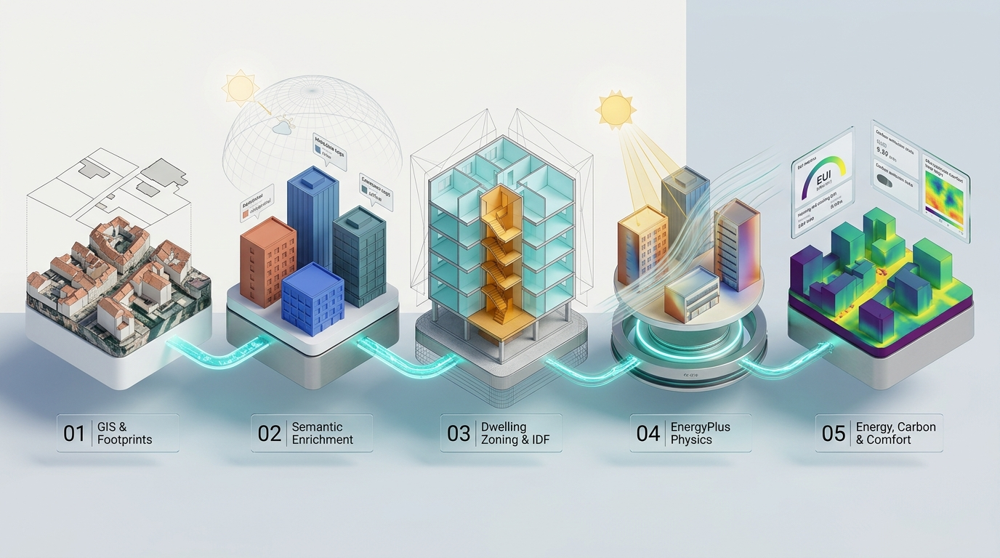
  <br>
  <em><b>Figure 1: The OpenUBEM 5-Stage Pipeline</b> — from GIS data acquisition, semantic enrichment, and ruled dwelling zoning to EnergyPlus physics simulation, urban carbon accounting, and pedestrian microclimate.</em>
</p>

---

## Key Highlights

- **Pure Physics, Zero Fitted Multipliers**: Every reported kWh originates from native EnergyPlus meters across 10 HVAC system families (central VAV, hydronic fan coils, heat pumps, etc.). No regression shortcuts.
- **True Footprint Geometry & Context Shading**: Buildings are extruded from real footprint polygons (not simplified shoebox proxies) with full 360° solar obstructions and adiabatic shared party walls within 20 m.
- **Dwelling-Level Ruled Stratification**: Automatically divides residential floor plates into individual dwelling zones (apartments) with unconditioned stair cores and corridor spines.
- **Global & European Archetype Support**: Out-of-the-box support for US archetypes (DOE/ASHRAE 90.1) and European building stocks (TABULA/EPISCOPE + ERA5 reanalysis weather).
- **Interactive 3D Digital Twins**: Zero-dependency WebGL/HTML5 3D neighbourhood viewers for exploring building heights, construction eras, and simulated heating EUI.
- **Auditable Data Provenance**: Every input field carries an explicit data provenance token (`observed`, `imputed`, or `standard_default`).

---

## Pipeline Overview

OpenUBEM operates as a modular, resume-capable 5-stage pipeline with an optional outdoor microclimate extension:

| Stage | Process | Primary Input | Key Output Artifact |
|---|---|---|---|
| **Step 1** | **Data Acquisition** | OSM Overpass / Cadastre / 3D Bags | `01_buildings_clean.gpkg` |
| **Step 2** | **Semantic Enrichment** | Archetype taxonomies (DOE/TABULA) + ERA5 | `02_classified.gpkg`, `02a_climate.gpkg`, `02b_enriched.gpkg` |
| **Step 3** | **IDF Generation** | Dwelling layouts & 20m shading envelope | `03_idf_manifest.parquet` + `idfs/*.idf` |
| **Step 4** | **EnergyPlus Simulation** | Multi-process EnergyPlus 23.1+ runner | `04_simulation_manifest.parquet` |
| **Step 5** | **Results & Carbon** | eGRID / European grid emissions factors | `05_results.gpkg`, `05_summary.json`, `viewer.html` |
| *Step 6* | *Outdoor Microclimate (Opt-in)* | Building massings & solar radiation | `06_mc_*.tif` / `06_mc_comfort.gpkg` (UTCI/PET) |

---

## 3D Architectural & Engineering Methodology

<p align="center">
  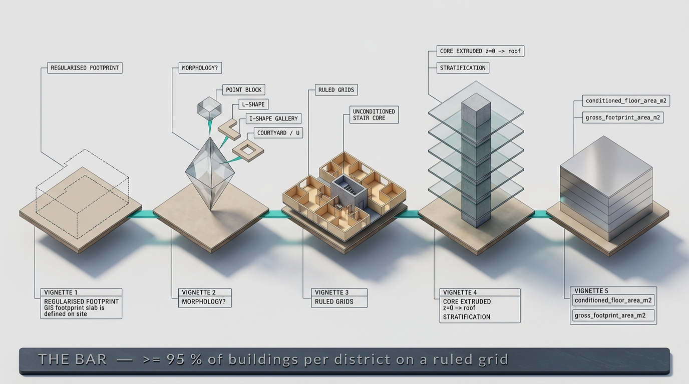
  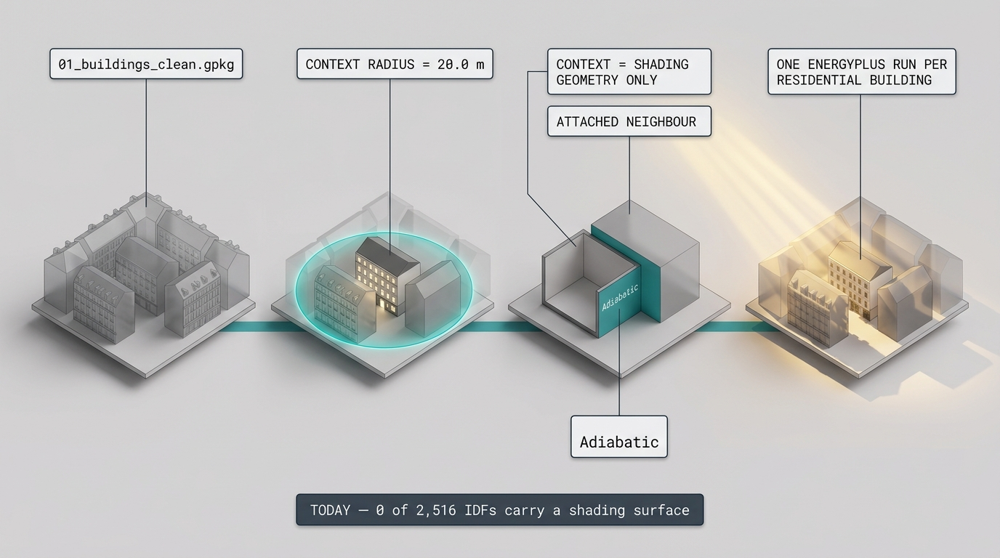
</p>

* **Left (Step 3: Ruled Dwelling Zoning):** Floor plates are classified by morphology (point block, corridor slab, courtyard, multi-wing), regularized, and bisected into equal-area conditioned dwelling zones (cyan) surrounding an unconditioned core or spine (amber).
* **Right (Step 4: Context Shading & Solar Exchange):** The target building (green) is simulated with surrounding context buildings (translucent grey) within a 20 m radius acting as real geometric shading surfaces, accounting for adiabatic boundary conditions and solar reflections.

---

## European & International Neighbourhood Showcase

OpenUBEM has been executed and verified across **10 residential districts in 10 countries across 4 continents**, mapping national cadastre registers and local building archetypes:

<p align="center">
  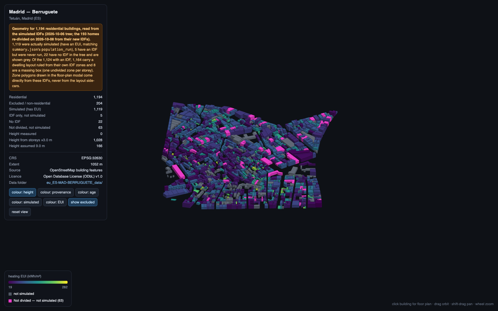
  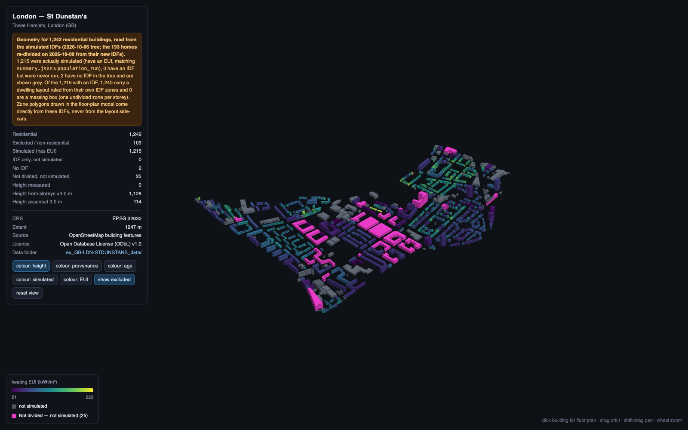
  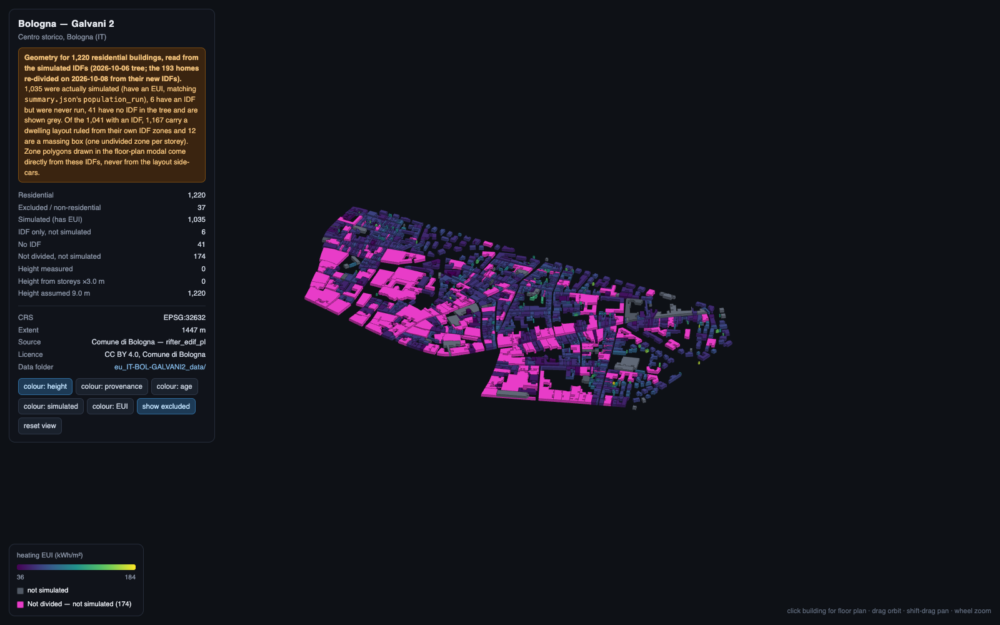
</p>
<p align="center">
  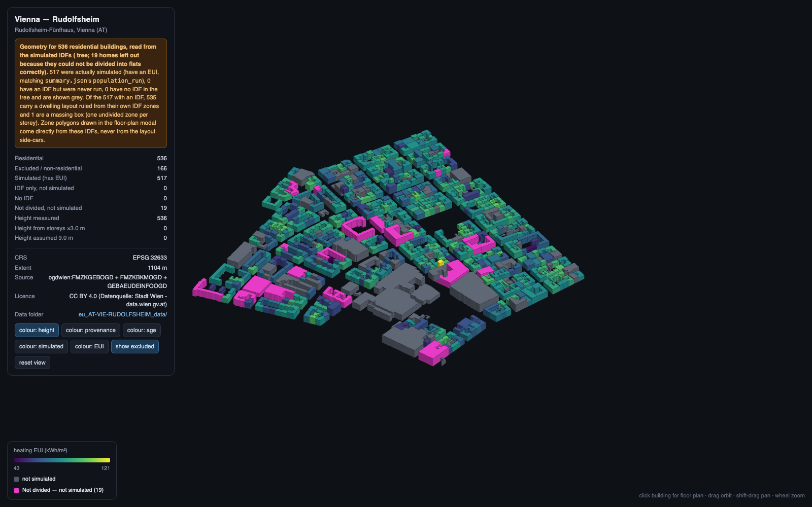
  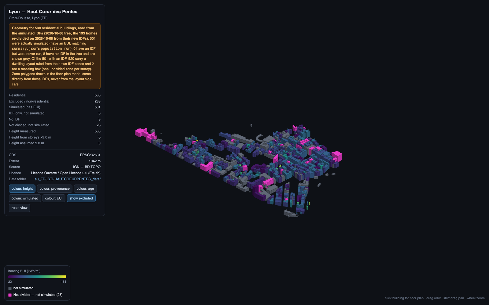
  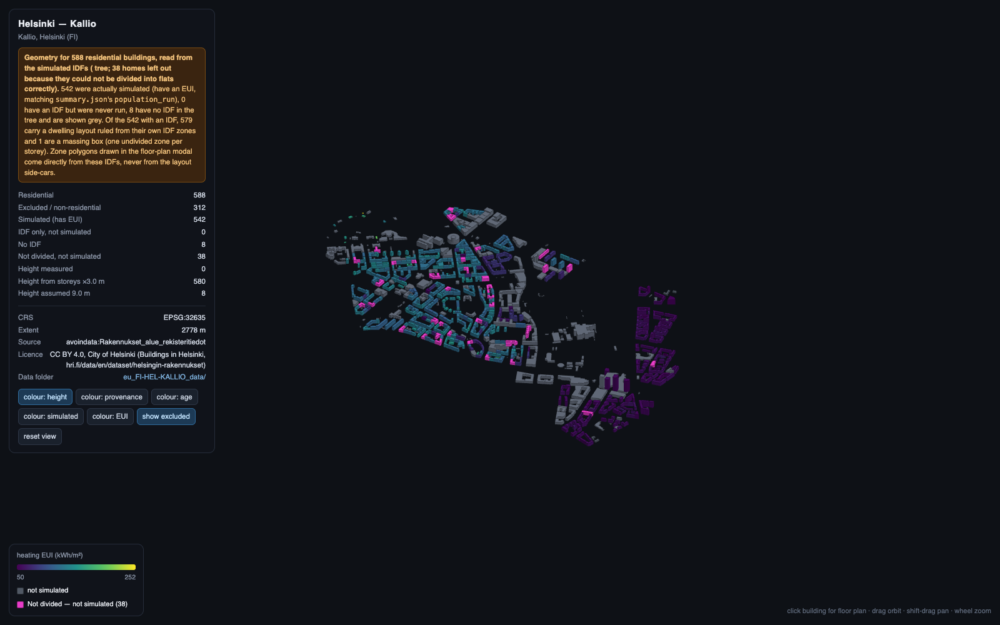
</p>
<p align="center">
  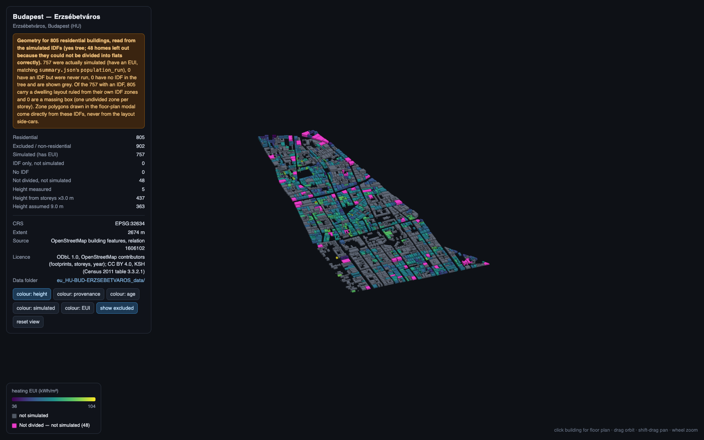
  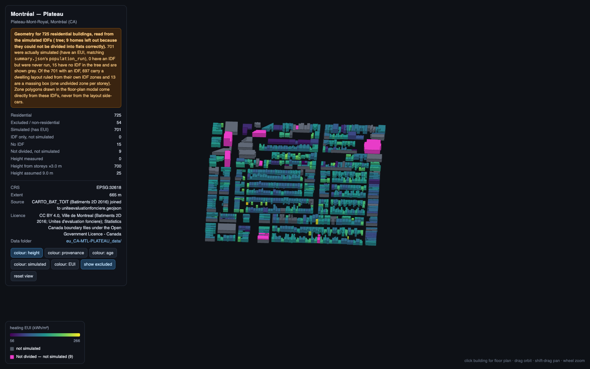
  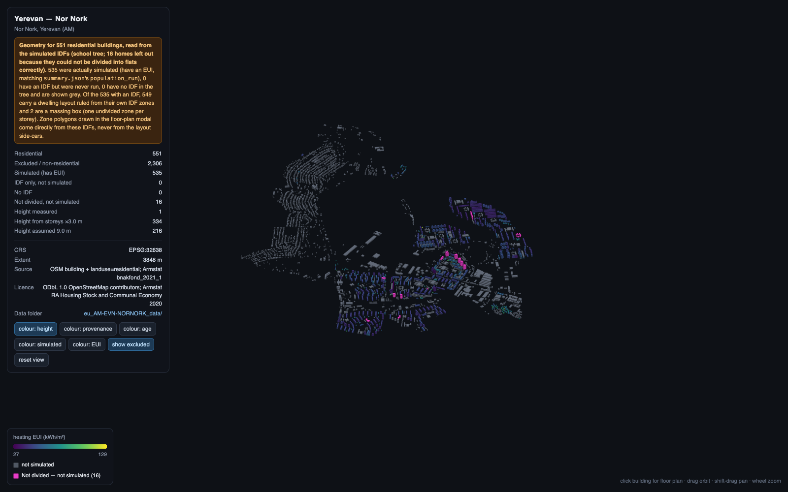
</p>

### District Performance Benchmarks

| District | Location | Buildings Simulated | Heating EUI (kWh/m²·a) | Weather Dataset | Interactive 3D Viewer |
|---|---|---|---|---|:---:|
| `ES-MAD-BERRUGUETE` | Madrid, Spain | 1,119 | **68.77** | ERA5 2010 | [Launch 3D](docs/docs_ACTIVE/europeanLocations/outputs_3D/eu_ES-MAD-BERRUGUETE_viewer.html) |
| `FR-LYO-HAUTCOEURPENTES` | Lyon, France | 501 | **57.81** | ERA5 2023 | [Launch 3D](docs/docs_ACTIVE/europeanLocations/outputs_3D/eu_FR-LYO-HAUTCOEURPENTES_viewer.html) |
| `GB-LDN-STDUNSTANS` | London, UK | 1,215 | **68.31** | ERA5 2015 | [Launch 3D](docs/docs_ACTIVE/europeanLocations/outputs_3D/eu_GB-LDN-STDUNSTANS_viewer.html) |
| `IT-BOL-GALVANI2` | Bologna, Italy | 1,035 | **58.16** | ERA5 2014 | [Launch 3D](docs/docs_ACTIVE/europeanLocations/outputs_3D/eu_IT-BOL-GALVANI2_viewer.html) |
| `AT-VIE-RUDOLFSHEIM` | Vienna, Austria | 517 | **77.58** | ERA5 2008 | [Launch 3D](docs/docs_ACTIVE/europeanLocations/outputs_3D/eu_AT-VIE-RUDOLFSHEIM_viewer.html) |
| `FI-HEL-KALLIO` | Helsinki, Finland | 542 | **96.42** | TMYx 2009-2023 | [Launch 3D](docs/docs_ACTIVE/europeanLocations/outputs_3D/eu_FI-HEL-KALLIO_viewer.html) |
| `HU-BUD-ERZSEBETVAROS` | Budapest, Hungary | 757 | **63.36** | TMYx 2009-2023 | [Launch 3D](docs/docs_ACTIVE/europeanLocations/outputs_3D/eu_HU-BUD-ERZSEBETVAROS_viewer.html) |
| `CA-MTL-PLATEAU` | Montréal, Canada | 701 | **140.90** | TMYx 2009-2023 | [Launch 3D](docs/docs_ACTIVE/europeanLocations/outputs_3D/eu_CA-MTL-PLATEAU_viewer.html) |
| `AM-EVN-NORNORK` | Yerevan, Armenia | 535 | **48.52** | TMYx 2009-2023 | [Launch 3D](docs/docs_ACTIVE/europeanLocations/outputs_3D/eu_AM-EVN-NORNORK_viewer.html) |
| `ZA-CPT-WOODSTOCK` | Cape Town, South Africa | 524 | **54.15** | TMYx 2009-2023 | *Internal Only (Licence)* |

---

## Quick Start

### 1. Prerequisites
- Python 3.10 or higher
- [EnergyPlus 23.1.0+](https://energyplus.net/) installed on PATH
- Geospatial dependencies (`geopandas`, `shapely`, `pyarrow`)

### 2. Installation
```bash
git clone https://github.com/orcunkoraliseri/OpenUBEM.git
cd OpenUBEM
pip install -e .
```

### 3. Run a Simulation Campaign
Run an end-to-end simulation on a specified district or bounding box:
```bash
# 1. Acquire GIS Footprints
python scripts/run_c4_regen.py --city madrid --step 1

# 2. Enrich Semantics & Climate
python scripts/run_c4_regen.py --city madrid --step 2

# 3. Generate Multi-Dwelling IDFs
python scripts/run_c4_regen.py --city madrid --step 3

# 4. Run EnergyPlus Parallel Fleet Simulation
python scripts/run_eu_s2_district_campaign.py --site ES-MAD-BERRUGUETE --jobs 8

# 5. Compile Results & Launch 3D Viewer
python scripts/generate_eu_3d_viewers.py --site ES-MAD-BERRUGUETE
open docs/docs_ACTIVE/europeanLocations/outputs_3D/eu_ES-MAD-BERRUGUETE_viewer.html
```

---

## Interactive 3D Digital Twin Viewer

Every completed simulation automatically compiles a standalone WebGL 3D viewer (such as `docs/docs_ACTIVE/europeanLocations/outputs_3D/eu_ES-MAD-BERRUGUETE_viewer.html`):
- **Inspect Attributes**: Color by building height, vintage era, height provenance, or heating EUI.
- **Dwelling Floor Plan Modal**: Click any building to inspect its exact multi-dwelling floor partition and zoning geometry.
- **Zero Server Setup**: Runs entirely in modern browsers without backend servers or proprietary tokens.

---

## Validation & Empirical Grounding

OpenUBEM does not tune parameters to pass targets; all physics thresholds are cited directly from ASHRAE 90.1, CBECS, and TABULA standards.
The model is systematically validated against empirical benchmarks:
- **NYC Local Law 84**: Validated against reported commercial and multifamily benchmark records.
- **CBECS 2018**: Checked across national archetype distributions.
- **LA EBEWE**: Verified against warm-climate cooling and plug-load profiles.

---

## Repository Documentation Map

> [!NOTE]
> **Looking for the exhaustive 64 KB technical reference?**
> The original unabridged engineering documentation with complete schemas, constant tables, HPC cluster SLURM scripts, and step-by-step diagnostic procedures is preserved intact:
> 👉 **[Full Technical Reference & Architecture Manual (v1)](docs/docs_ACTIVE/README_progress/README_v1.md)**

Other essential resources:
- [European & International Project Hub](docs/docs_ACTIVE/europeanLocations/BRIEF_european_locations_v5.md): Comprehensive methodology for European locations.
- [Graphical Abstract Image Prompts](docs/docs_ACTIVE/README_progress/prompt_graphical_abstract_3d.md): Full prompt suite (§2.1, §2.2, §2.3) for generating OpenUBEM imagery.
- [Graphic Summary Prompt Styles Guide](docs/docs_EXPLANATION/OpenUBEM_graphic_summary_prompt_styles.md): General principles for scientific illustration in UBEM.
- [Dwelling Layout Rules](docs/docs_ACTIVE/europeanLocations/rules/): Architectural subdivision specifications.

---

## License

OpenUBEM is released under the **Apache 2.0 License**. See [LICENSE](LICENSE) for details.
All external geographic data (OpenStreetMap, Cadastre registers) respect their respective attribution and licensing rules.
